WebGL Forward+ and Clustered Deferred Shading
======================

**University of Pennsylvania, CIS 565: GPU Programming and Architecture, Project 4**

* Neel Shejwalkar
  * [LinkedIn](https://www.linkedin.com/in/neel-shejwalkar/), [twitter](https://x.com/neelshej)
* Tested on: **Google Chrome 155.0.8059.40** on
  Windows 11, i7-10510U @ 1.80GHz 16GB, MX250 (GP108) 2GB (Personal Computer)

### Live Demo

[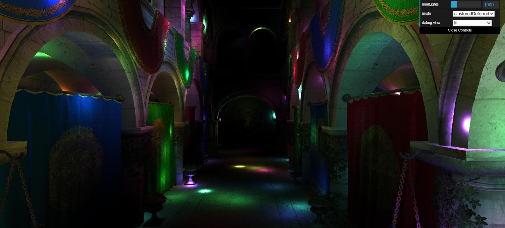](https://nshejwalkar.github.io/Project4-WebGPU-Forward-Plus-and-Clustered-Deferred/)

### Demo Video/GIF

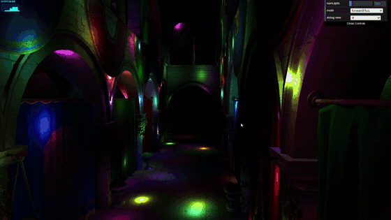

### (README)

#### Forward+ Rendering
Forward+ rendering works by spatially grouping the scene into clusters (across the screen and depth), then calculating the total number of lights that interact with that cluster using a separate compute pass before any of the rendering begins. The fragment shader then uses this information to loop over only the smaller number of lights for that cluster, rather than every light in the scene as we did with the naive (regular forward rendering) pipeline.

The best case scenario for F+ rendering here is when there are many small lights all spread across the scene. In this case, each cluster must only calculate lighting only a small number of lights, resulting in an especially pronounced benefit in performance over naive rendering, which must still loop over all of those many lights.

The worst case scenarios are when some properties of the scene degenerate the algorithm to naive rendering, meaning we pay for the overhead with no benefit. For example, if the radius of the lights are very large (so every cluster contains most of the lights), the fragment shader still has to loop through every light anyway. Similarly, if there are very few lights in the scene, the naive fragment loop becomes cheap, and the F+ pipeline pays for its overhead while not being able to exercise its benefits at such a low scale.

The tradeoff for using F+ rendering is the overhead of the compute pass and the cluster buffer. This cluster buffer, at a size of clusters × (1 + maxLightsPerCluster) × 4 bytes, has to be reserved in advance regardless of how full the clusters actually are. This makes the maximum lights per cluster parameter a tradeoff in scenes with lots of lights: a high cap reserves more memory, but a lower one risks clusters being incorrectly lighted or visible artifacts. Separately, finding optimal grid parameters for the clusters requires extra tuning effort.

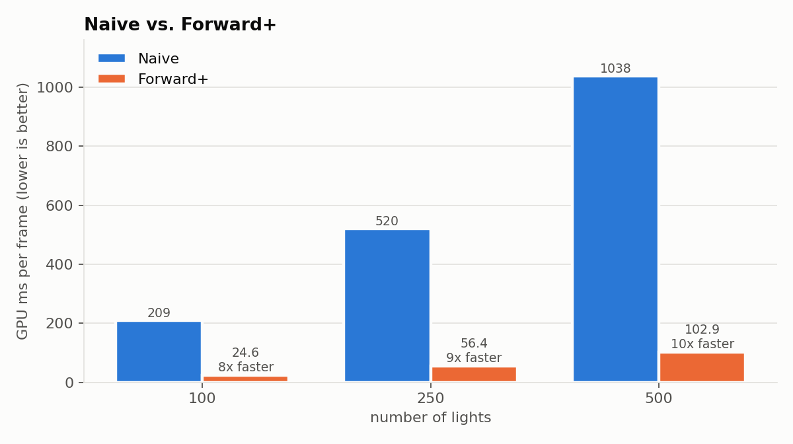
Forward+ is clearly far more performant than naive rendering. Note: for 1000 lights and above, naive rendering on my laptop took over 2 seconds (!) per frame, causing Window's GPU watchdog to kill the rendering.

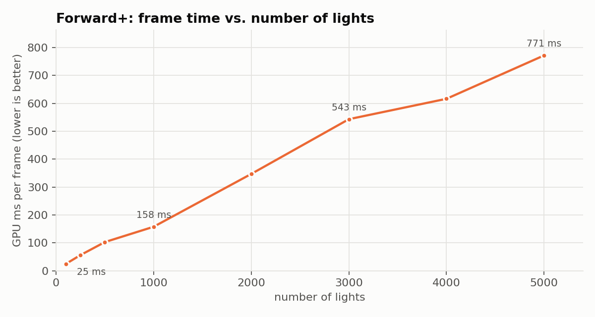
Forward+ scales approximately linearly with the number of lights. This makes sense, as each fragment only loops over its' cluster lights. Note that a linear speedup would also be expected regardless of whether our scene was closer to the best case "spread out" scenario above or has clumped lights (some fragments doing far more work), just with a higher slope. This is because the cost of naive rendering is also O(lights*fragments).

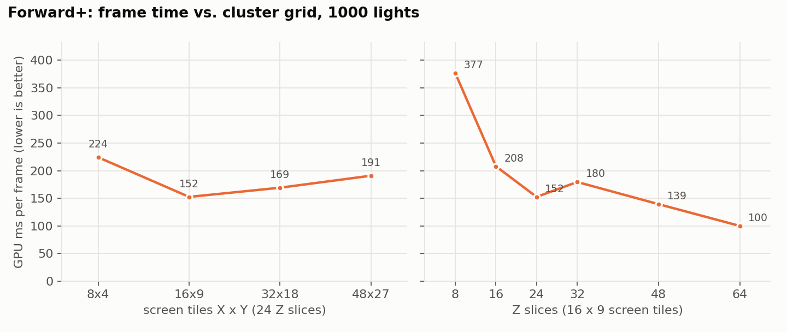
When fixing the number of Z slices and testing different X and Y grid configurations, I tested different layouts matching my Chrome window's aspect ratio. 16x9 seems to be the fastest, striking the best balance between large clusters with many lights (putting more work into each loop of the fragment shader) and smaller clusters with fewer lights (offloading more work onto the compute pass). It seems like the dimension of the Z grid matters far more, however, whose clusters are laid out not linearly like with the X/Y dimensions, but exponentially bigger the farther away from the screen they are. A large number of Z slices resulted in 3x faster frame times than smaller ones.

##### Debug images
Lights per cluster, radius 1 (left) vs. radius 4 (right):

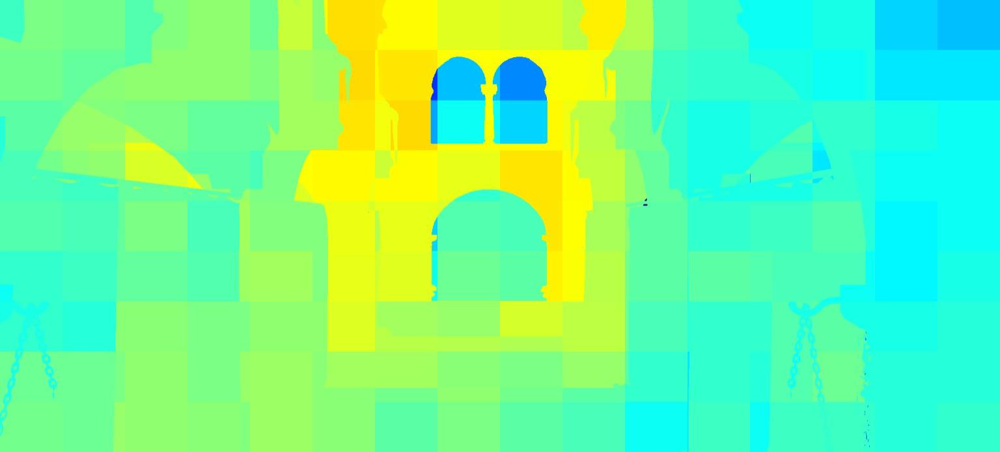 
These heatmaps represent the number of lights in a particular pixel's cluster. Cooler colors represent fewer lights, redder colors are more lights, and a white pixel is one where that cluster the maximum number of lights. The radius 1 heatmap is mostly cyan and green, with yellow in the middle where the lights are densest, meaning each cluster holds a couple dozen lights, resulting in 54 ms/frame. For the radius 4 heatmap, each light overlaps many more clusters, and so clusters are much redder and some completely fill the buffer, resulting in 698 ms/frame. 

Lights per cluster, 500 lights (left) vs. 5000 lights (right):

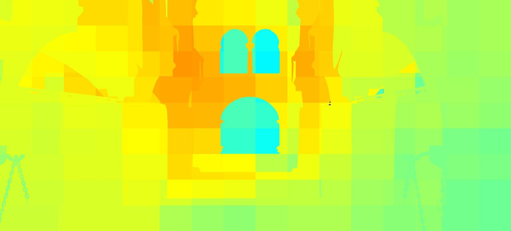 
Similar results can be shown for 500 lights vs 5000 lights, supporting the analysis above.

#### Deferred Rendering
Clustered deferred Rendering works by splitting the calculation of the geometry and the lighting into two separate pipelines, decoupling the two. The geometry render pass decides what surface is visible at each pixel by writing each pixel's world position, normal, albedo into its G-buffer textures, and does no lighting. The later lighting render pass then only calculates the lighting using this information once per pixel, the same way forward+ did, over its cluster's lights.

The best case scenario for deferred rendering is when the scene has expensive lighting, like many lights with a large radius, or heavy overdraw. Here, the benefits of deferring the rendering versus forward are clearer, as the expensive per-fragment lighting loop becomes per-pixel.

The worst case scenario is when there are few lights, little overdraw (like the camera facing a flat wall), or when running the rendering on a low-bandwidth GPU. In the first case, the G-buffer pass, which costs a fixed amount of time regardless of the number of lights, takes up more of the frame time. For the second, the number of fragments are roughly equal to the number of pixels, resulting in the overhead of this method overtaking its benefits. For the third, the large amount of buffer read/writes means that the rendering is more likely to become bandwidth bound quickly.

The overhead for deferred rendering is most in the large memory bandwidth needed. Every pixel stores 8 bytes for position, 8 for normal, and 4 for albedo, resulting in resolution*20 bytes written and read every frame, which scales badly for high resolution or low-bandwidth GPUs. For materials with more attributes (like roughness, specularity, etc) requires even more G-buffer channels (as the lighting is calculated for the entire screen at once), whereas with Forward+, these are easily handled by each material running its own fragment shader. The same problems for clustering in F+ are also inherited here.

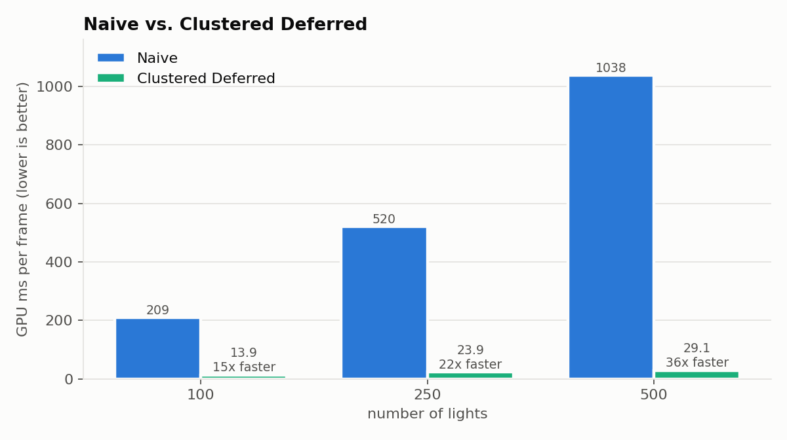
Clustered deferred rendering performs far better than naive rendering, as well as forward+ rendering. As mentioned above, I was not able to benchmark any higher than 500 lights for naive rendering.

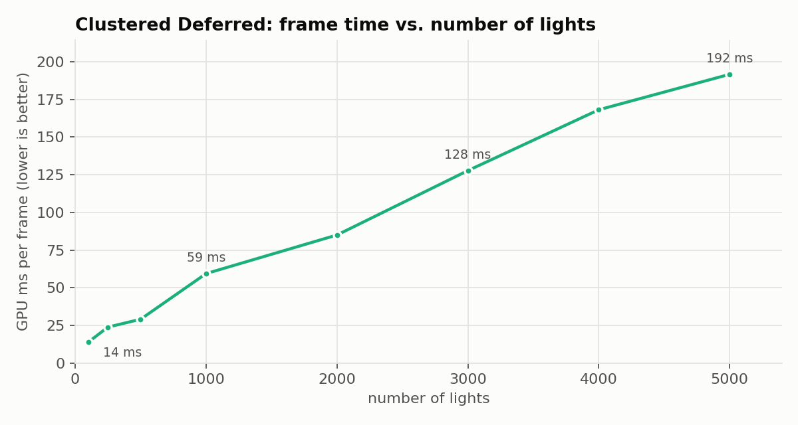
Similar to forward+ rendering, the performance of this method scales linearly with the number of lights, with the same logic as before: each pixel loops over the number of lights in its cluster. As the lighting fragment shader is run per-pixel and not per-fragment, it scales better than F+.

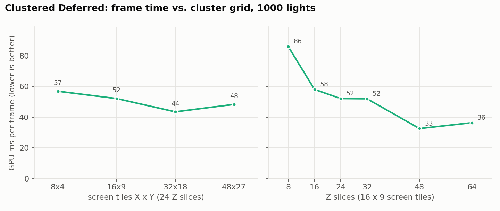
Interestingly, the X/Y layout of the cluster tiles seemed to matter even less for deferred rendering vs forward+, and the optimal configuration was different (slightly higher) than before. The tradeoffs are similar to before, where larger clusters result in more work for each pixel of the lighting pass, and smaller clusters require more work for the first pass. Again, the Z dimension mattered more, with a smaller number of slices resulting in massive clusters farther away from the image plane (simply due to the exponential nature of the slicing). A larger number of slices was far better for performance.

##### Debug images
G-buffer albedo (left), normal (middle), and position (right):

 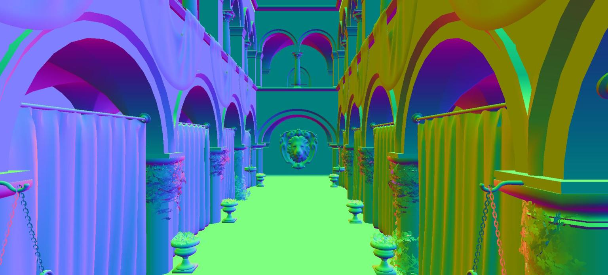 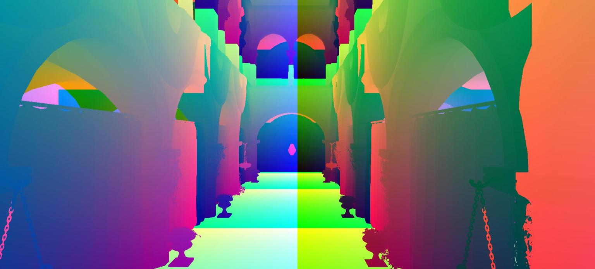
These three images show exactly what the first deferred pass writes for every pixel (every frame). Importantly, its clear to see that these do not change with the light count, light radius, or cluster grid, meaning the cost to write and read them every frame is constant (and potentially high, depending on the resolution and if more buffers are added for more complex materials).

#### Overall Analysis
Clustered deferred rendering was clearly faster than forward+ for me. It inherits many of the same benefits as the clustering from F+, with the added benefit of having the lighting decoupled from the geometry resulting in the performance scaling per-pixel. While deferred rendering does add extra overhead and has specific downsides compared to forward, the scene we ran hit none of these downsides. As mentioned above, forward+ rendering would be better for scenes with a small number of lights spread across the scene, on a low bandwidth GPU, or on a scene with little overdraw. Deferred rendering shines in any case on a high bandwidth GPU, or where the number of fragments being higher than the number of pixels results in far more computation, like a scene with many high-radius lights. The main tradeoffs for each were also clear: deferred adds far more overhead via writing and reading to buffers, while forward needs to loop over every fragment during its lighting pass. These main differences are what implies their best and worst-case scenarios for the type of scenes that should be rendered using these two methods.

### Credits

- [Vite](https://vitejs.dev/)
- [loaders.gl](https://loaders.gl/)
- [dat.GUI](https://github.com/dataarts/dat.gui)
- [stats.js](https://github.com/mrdoob/stats.js)
- [wgpu-matrix](https://github.com/greggman/wgpu-matrix)
